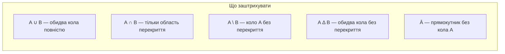
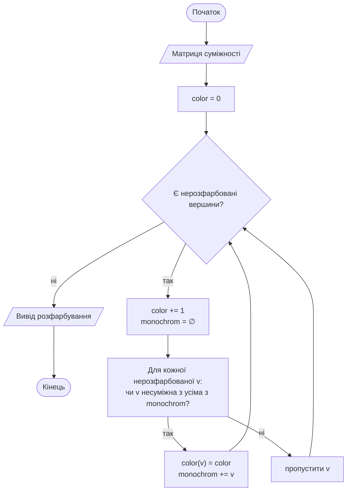

# 📘 Дискретна математика — конспект до лабораторних робіт

> **КПІ ім. Ігоря Сікорського · ФІОТ · Кафедра обчислювальної техніки**
> Конспект складено за методичними вказівками (Новотарський М. А., 2024) та виконаними лабораторними роботами №1–4. Лабораторна №5 розібрана за методичкою.
> Мова реалізації — **Python 3 + tkinter** (у лаб. №3 обов'язково ще й **NetworkX**).

---

## 🧭 Зміст

| № | Тема | Ключові поняття | Алгоритм / результат |
|---|------|-----------------|----------------------|
| [0](#0-загальні-вимоги-та-варіанти) | Загальні вимоги | Варіанти, структура звіту | Формули варіантів |
| [1](#1-лабораторна-1--множини) | **Множини** | Операції, закони алгебри множин, діаграми Венна | Спрощення виразу + покрокове обчислення |
| [2](#2-лабораторна-2--бінарні-відношення) | **Бінарні відношення** | Властивості, композиція, замикання | Узгоджені відношення S та R |
| [3](#3-лабораторна-3--графи-остови-найкоротші-шляхи) | **Графи** | Матриці, остов, шляхи | Прима–Краскала, Дейкстра, Флойд |
| [4](#4-лабораторна-4--розфарбування-графів) | **Розфарбування графів** | Хроматичне число, оцінки | Жадібний, евристичні алгоритми |
| [5](#5-лабораторна-5--комбінаторика) | **Комбінаторика** | Перестановки, розміщення, сполучення | Генерація комбінацій, код Грея, розбиття |
| [6](#6-шпаргалка) | Шпаргалка | Формули і Python-еквіваленти | — |

---

## 0. Загальні вимоги та варіанти

### Технічні вимоги (з методички)

- Мова: **Python**, середовище — PyCharm Edu.
- GUI — бібліотека **tkinter**.
- Ввід даних **з клавіатури та з файлу**.
- Лаб. №3: ребра остова / найкоротшого шляху **виділяти кольором**, граф малювати через **NetworkX**.
- Код розбивають на **окремі модулі** (функції обчислень — окремо від інтерфейсу).

### Формули варіантів

| Лаб. | Формула | Пояснення |
|------|---------|-----------|
| 1, 2 | `Z = (i + G % 60) % 30 + 1` | `i` — номер у списку групи, `G` — число з назви групи |
| 3 | `I = NZK % 10 + 1` | `NZK` — номер залікової книжки |
| 4 | `I = NZK mod 6 + 1` | варіант = номер завдання з теорії |
| 5 | `I = NZK mod 26 + 1` | варіант = номер пункту завдання |

```python
G = 45          # група ІО-45
i = 23          # номер у списку
print("Мій варіант:", (i + G % 60) % 30 + 1)   # → 9
```

### Структура звіту

1. Титульний лист (НТУУ «КПІ», ФІОТ, кафедра ОТ, дисципліна, номер і тема роботи, виконав, залікова книжка, перевірив, місто і рік).
2. Мета та загальне завдання.
3. Варіант індивідуального завдання.
4. Короткі теоретичні відомості (лише те, що використано в роботі).
5. Блок-схеми алгоритмів.
6. Код індивідуальної частини.
7. Результати виконання на контрольному прикладі (скріншоти).
8. Висновки.

---

## 1. Лабораторна №1 — Множини

**Тема:** множини, основні властивості та операції, діаграми Венна.
**Мета:** вивчити аксіоми, закони й теореми теорії множин; обчислити логічний вираз послідовним застосуванням операцій.

### 1.1. Основні поняття

| Поняття | Означення |
|---------|-----------|
| **Множина** | Сукупність різних між собою об'єктів, об'єднаних спільною ознакою |
| **Порожня множина** `∅` | Не містить елементів |
| **Скінченна / нескінченна** | Кількість елементів виражається / не виражається скінченним числом |
| **Підмножина** `A ⊆ B` | Кожен елемент `A` є елементом `B` |
| **Строга підмножина** `A ⊂ B` | `A ⊆ B` і `A ≠ B` |
| **Рівність** | `A = B`, якщо `A ⊆ B` та `B ⊆ A` |
| **Потужність** `\|A\|` | Кількість елементів скінченної множини |
| **Універсальна множина** `U` | Містить усі розглядувані множини як підмножини |
| **Булеан** `P(A)` | Множина всіх підмножин; `\|P(A)\| = 2ⁿ` |

Стандартні числові множини: **N** — натуральні, **Z** — цілі, **Q** — раціональні, **R** — дійсні.

> ⚠️ **Належність ≠ включення.** Для `A = {1, 3, 6, 13}`: `3 ∈ A`, але `{3, 6} ⊂ A`, а `{3, 6} ∉ A`.

**Способи задавання множин**

- **Перерахуванням** — `A = {2, 3, 5, 7, 11}` (тільки скінченні).
- **Породжуючою процедурою** — наприклад, степені двійки: `1 ∈ M`; якщо `m ∈ M`, то `2m ∈ M`.
- **Характеристичною властивістю** — `A = {x | P(x)}`.

**Приклад булеана.** `A = {a, b, c, d}` → `|P(A)| = 2⁴ = 16`:
`∅`, `{a}`, `{b}`, `{c}`, `{d}`, `{a,b}`, `{a,c}`, `{a,d}`, `{b,c}`, `{b,d}`, `{c,d}`, `{a,b,c}`, `{a,b,d}`, `{a,c,d}`, `{b,c,d}`, `{a,b,c,d}`.

### 1.2. Операції над множинами

| Операція | Запис | Означення | Python |
|----------|-------|-----------|--------|
| Об'єднання | `A ∪ B` | належать хоча б одній з `A`, `B` | `A \| B` |
| Перетин | `A ∩ B` | належать і `A`, і `B` | `A & B` |
| Різниця | `A \ B` | належать `A`, але не `B` | `A - B` |
| Симетрична різниця | `A Δ B` | `(A \ B) ∪ (B \ A)` | `A ^ B` |
| Доповнення | `Ā` | елементи `U`, що не належать `A` | `U - A` |

- **Унарна** операція — над однією множиною (доповнення).
- **Бінарні** — над двома (∪, ∩, \, Δ).

**Приклад.** `A = {2,3,5,6,7}`, `B = {1,2,3,7,9}`:

```
A ∪ B = {1, 2, 3, 5, 6, 7, 9}
A ∩ B = {2, 3, 7}
A \ B = {5, 6}
A Δ B = {1, 5, 6, 9}
```

### 1.3. Діаграми Венна

Універсальну множину зображують **прямокутником**, множини — **колами**. Заштрихована область і є результатом операції.



### 1.4. Тотожності алгебри множин

| № | Закон | Об'єднання | Перетин |
|---|-------|-----------|---------|
| 1 | Комутативність | `A ∪ B = B ∪ A` | `A ∩ B = B ∩ A` |
| 2 | Асоціативність | `A ∪ (B ∪ C) = (A ∪ B) ∪ C` | `A ∩ (B ∩ C) = (A ∩ B) ∩ C` |
| 3 | Дистрибутивність | `A ∪ (B ∩ C) = (A ∪ B) ∩ (A ∪ C)` | `A ∩ (B ∪ C) = (A ∩ B) ∪ (A ∩ C)` |
| 4 | Дії з ∅ та U | `A ∪ ∅ = A`; `A ∪ Ā = U`; `A ∪ U = U` | `A ∩ U = A`; `A ∩ Ā = ∅`; `A ∩ ∅ = ∅` |
| 5 | Ідемпотентність | `A ∪ A = A` | `A ∩ A = A` |
| 6 | **де Моргана** | `¬(A ∪ B) = Ā ∩ B̄` | `¬(A ∩ B) = Ā ∪ B̄` |
| 7 | Поглинання | `A ∪ (A ∩ B) = A` | `A ∩ (A ∪ B) = A` |
| 8 | Склеювання | `(A ∩ B) ∪ (A ∩ B̄) = A` | `(A ∪ B) ∩ (A ∪ B̄) = A` |
| 9 | Порецького | `A ∪ (Ā ∩ B) = A ∪ B` | `A ∩ (Ā ∪ B) = A ∩ B` |
| 10 | Подвійне доповнення | `¬¬A = A` | |
| 11 | Різниця через доповнення | `A \ B = A ∩ B̄` | |
| 12 | Симетрична різниця | `A Δ B = (A \ B) ∪ (B \ A)` | |

> 💡 **Ідемпотентність** — повторна дія над об'єктом не змінює його.

### 1.5. Як спрощувати вираз

**Спрощення вважається максимальним, якщо кожна множина входить у формулу лише один раз.**

Алгоритм дій:

1. Позбутися різниць: `A \ B → A ∩ B̄`.
2. Застосувати закони де Моргана до доповнень над дужками.
3. Шукати «готові» шаблони: `A ∪ Ā`, `A ∪ A`, поглинання, склеювання, Порецького.
4. Підставляти `U` та `∅` за правилами п. 4.

### 1.6. Розібраний приклад (варіант 9)

**Початковий вираз (1):**

```
D = ( ( ( (A ∪ Ā) ∩ A ) \ (B ∪ B) ) ∩ ¬( C ∪ (C ∩ B) )
```

**Спрощення:**

| Крок | Вираз | Який закон |
|------|-------|-----------|
| 1 | `((A ∪ Ā) ∩ A) \ (B ∪ B) ∩ ¬(C ∪ (C ∩ B))` | початковий |
| 2 | `(U ∩ A) \ (B ∪ B) ∩ ¬(C ∪ (C ∩ B))` | `A ∪ Ā = U` |
| 3 | `(A \ B) ∩ ¬(C ∪ (C ∩ B))` | `U ∩ A = A`, `B ∪ B = B` |
| 4 | `(A \ B) ∩ C̄` | поглинання: `C ∪ (C ∩ B) = C` |
| 5 | **`D = A ∩ B̄ ∩ C̄`** | `A \ B = A ∩ B̄` |

**Операція (2):** `X = A`, `Y = C`, `Z = X \ Y`.

### 1.7. Реалізація: початковий і спрощений вираз

Кожну операцію виконують **окремим кроком** (так вимагає інтерфейс: «один крок — одна логічна операція»).

```mermaid
flowchart TB
    subgraph Початковий
    a0([Початок]) --> a1[/Ввід A, B, C, U/]
    a1 --> s1["Крок 1: A ∪ Ā"] --> s2["Крок 2: крок1 ∩ A"] --> s3["Крок 3: B ∪ B"]
    s3 --> s4["Крок 4: крок2 ∩ B̄"] --> s5["Крок 5: C ∩ B"] --> s6["Крок 6: C ∪ крок5"]
    s6 --> s7["Крок 7: крок4 ∩ C̄"] --> a2[/Вивід D/] --> a3([Кінець])
    end
    subgraph Спрощений
    b0([Початок]) --> b1[/Ввід A, B, C, U/] --> t1["Крок 1: A ∩ B̄"] --> t2["Крок 2: крок1 ∩ C̄"] --> b2[/Вивід D/] --> b3([Кінець])
    end
```



```python
# --- початковий вираз ---
def initial(A, B, C, U):
    s1 = A | (U - A)          # A ∪ Ā
    s2 = s1 & A               # (A ∪ Ā) ∩ A
    s3 = B | B                # B ∪ B
    s4 = s2 - s3              # ... \ (B ∪ B)
    s5 = C & B                # C ∩ B
    s6 = C | s5               # C ∪ (C ∩ B)
    return s4 & (U - s6)      # ... ∩ ¬(...)

# --- спрощений вираз ---
def simplified(A, B, C, U):
    return (A & (U - B)) & (U - C)

# --- операція (2): Z = X \ Y, власна реалізація без оператора "-" ---
def my_diff(X, Y):
    return {x for x in X if x not in Y}
```

**Перевірка правильності спрощення** (вимога п. Ж методички):

```python
U = set(range(0, 21))
A = {10, 12, 14, 15, 16}
B = {2, 4, 5, 12, 19}
C = {6, 7, 8, 9, 10}

print(initial(A, B, C, U))      # {14, 15, 16}
print(simplified(A, B, C, U))   # {14, 15, 16}
print("Результати D однакові" if initial(A, B, C, U) == simplified(A, B, C, U)
      else "Результати D різні")

print(my_diff(A, C) == A - C)   # True → {12, 14, 15, 16}
```

### 1.8. Вимоги до інтерфейсу (5 вікон)

| Вікно | Зміст |
|-------|-------|
| **№1** | Головне меню (виклик вікон 2–5); ПІБ, група, номер у списку, результат обчислення варіанта; задання **потужностей** A, B, C; **випадкова генерація** множин; **ручний ввід**; діапазон **універсальної множини** |
| **№2** | Елементи множин; кнопки **покрокового** виконання початкового виразу; операнди та результат кожної операції; множина `D` + **збереження у файл** |
| **№3** | Те саме для **спрощеного** виразу |
| **№4** | Множини `X`, `Y`; результат `Z` операції (2), обчислений **вашою функцією** |
| **№5** | Зчитування з файлів: `D` початкове, `D` спрощене, `Z` (своя функція), `Z` (стандартна функція Python); кнопки **порівняння** |

Елементами множин можуть бути **числа від 0 до 255**.

### 1.9. Контрольні запитання

<details>
<summary><b>Показати відповіді</b></summary>

1. **Чим множина відрізняється від довільної сукупності?** Елементи множини **різні** й об'єднані спільною ознакою; порядок і повтори не важливі.
2. **Способи задавання:** перерахуванням, породжуючою процедурою, характеристичною властивістю.
3. **Операції:** об'єднання, перетин, різниця, симетрична різниця, доповнення.
4. **Чи існує множина без елементів?** Так — порожня множина `∅`.
5. **`A = {1, 9, 25}`, `B = {2300, 25, 1}` — однакова потужність?** Так: `|A| = |B| = 3` (хоча самі множини не рівні).
6. **Діаграми Венна** — див. розділ 1.3.
7. **Тотожні перетворення** — див. таблицю 1.4.
8. **`A = {1,54,12,45,11,34}`, `B = {2,11,12,13,45,54,34}`, `C = {1,2,13}`.** Спільні елементи (11, 12, 34, 45, 54) у результат не потрапили, а `C` складається з елементів, що є **лише в одній** із множин → це **симетрична різниця** `A Δ B`: `A \ B = {1}`, `B \ A = {2, 13}`.

</details>

---

## 2. Лабораторна №2 — Бінарні відношення

**Тема:** бінарні відношення, їх властивості та операції.
**Мета:** вивчити властивості бінарних відношень і навчитися виконувати над ними операції.

### 2.1. Основні означення

- **Упорядкована пара** `⟨x, y⟩` — два об'єкти в певному порядку. `⟨x, y⟩ = ⟨u, v⟩` тоді й тільки тоді, коли `x = u` і `y = v`.
- **Декартів добуток** `X × Y = {⟨x, y⟩ | x ∈ X, y ∈ Y}`; `|X × Y| = |X| · |Y|`.
- **Бінарне відношення** `R ⊆ X × Y` — довільна підмножина пар. Запис: `⟨x, y⟩ ∈ R` або `xRy`.
- **Область визначення** `D_R = {x | ∃y: ⟨x, y⟩ ∈ R}`, **область значень** `E_R = {y | ∃x: ⟨x, y⟩ ∈ R}`.

**Способи задавання відношення на скінченній множині**

1. **Списком** упорядкованих пар.
2. **Матрицею** суміжності: `aᵢⱼ = 1`, якщо `xᵢ R xⱼ`, інакше `0`.
3. **Графом** (стрілка `a → b`, якщо `aRb`).

**Приклад.** `A = {1, 2, 3}`, `B = {2, 3, 4}`

```
A × B = {(1,2),(1,3),(1,4),(2,2),(2,3),(2,4),(3,2),(3,3),(3,4)}
B × A = {(2,1),(2,2),(2,3),(3,1),(3,2),(3,3),(4,1),(4,2),(4,3)}

(A×B) \ (B×A) = {(1,2),(1,3),(1,4),(2,4),(3,4)}
(A×B) ∩ (B×A) = {(2,2),(2,3),(3,2),(3,3)}
```

### 2.2. Властивості відношень на множині A

| Властивість | Означення | Ознака в **матриці** |
|-------------|-----------|---------------------|
| **Рефлексивність** | `⟨a,a⟩ ∈ R` для всіх `a` | головна діагональ — **усі 1** |
| **Антирефлексивність** | `⟨a,a⟩ ∉ R` для жодного `a` | головна діагональ — **усі 0** |
| **Симетричність** | `⟨a,b⟩ ∈ R ⇒ ⟨b,a⟩ ∈ R` | матриця симетрична: `cᵢⱼ = cⱼᵢ` |
| **Антисиметричність** | `⟨a,b⟩, ⟨b,a⟩ ∈ R ⇒ a = b` | немає симетричних одиниць поза діагоналлю |
| **Транзитивність** | `⟨a,b⟩, ⟨b,c⟩ ∈ R ⇒ ⟨a,c⟩ ∈ R` | якщо `cᵢⱼ = 1` і `cⱼₖ = 1`, то `cᵢₖ = 1` |
| **Еквівалентність** | рефлексивне + симетричне + транзитивне | — |

```python
def is_reflexive(R, A):     return all((a, a) in R for a in A)
def is_antireflexive(R, A): return all((a, a) not in R for a in A)
def is_symmetric(R):        return all((b, a) in R for a, b in R)
def is_antisymmetric(R):    return all(not ((b, a) in R and a != b) for a, b in R)
def is_transitive(R):       return all((a, d) in R for a, b in R for c, d in R if b == c)
```

### 2.3. Операції над відношеннями

Оскільки відношення — це множини пар, діють усі операції над множинами:

| Операція | Означення |
|----------|-----------|
| Об'єднання `R₁ ∪ R₂` | пара належить `R₁` **або** `R₂` |
| Перетин `R₁ ∩ R₂` | пара належить **обом** |
| Різниця `R₁ \ R₂` | належить `R₁` і не належить `R₂` |
| Доповнення `R̄ = U \ R` | де `U = A × B` |

Додаткові операції:

| Операція | Означення | Приклад |
|----------|-----------|---------|
| **Обернене** `R⁻¹` | `{⟨b,a⟩ \| ⟨a,b⟩ ∈ R}` | «старший» ↔ «молодший» |
| **Композиція** `S ∘ R` | `{⟨a,c⟩ \| ∃b: ⟨a,b⟩ ∈ R, ⟨b,c⟩ ∈ S}` | «дочка» ∘ «дочка» = «онука» |
| **Транзитивне замикання** `R⁺` | усі пари, з'єднані ланцюжком із `R` | «бути прямим нащадком» |
| **Рефлексивне замикання** `R*` | `R⁺ ∪ E`, де `E = {⟨a,a⟩}` — тотожне відношення | — |

- Якщо `R` транзитивне, то `R⁺ = R`. Якщо транзитивне й рефлексивне, то `R* = R`.
- `R⁺` — **найменше транзитивне** відношення, що містить `R`.

**Процедура обчислення `R⁺` (за методичкою):**

1. `R₁ := R`.
2. `R₂ := R₁ ∪ (R₁ ∘ R₁)`.
3. Якщо `R₁ = R₂` — перейти до кроку 4, інакше `R₁ := R₂` і повторити крок 2.
4. `R⁺ = R₂`.

```python
def inverse(R):
    return {(b, a) for a, b in R}

def compose(R, S):                       # S ∘ R
    return {(a, c) for a, b in R for b2, c in S if b == b2}

def transitive_closure(R):
    R1 = set(R)
    while True:
        R2 = R1 | compose(R1, R1)
        if R2 == R1:
            return R1
        R1 = R2

R = {(1, 2), (2, 3), (3, 4)}
print(sorted(transitive_closure(R)))
# [(1,2), (1,3), (1,4), (2,3), (2,4), (3,4)]
```

### 2.4. Узгоджені (несуперечливі) відношення

Завдання лаби: за варіантом побудувати алгоритм, що **одночасно** формує **два відношення S та R** так, щоб вони не суперечили одне одному та здоровому глузду.

**Приклад варіанта 9:** `aSb`, якщо **a — мати b**; `aRb`, якщо **a — сестра b**.

Правила узгодженості:

| Відношення | Що перевіряти |
|-----------|---------------|
| **S** (мати) | `a` — жіноче ім'я; `a ≠ b`; у дитини **одна** мати |
| **R** (сестра) | обидві — жіночі імена; `a ≠ b`; `a` та `b` мають **спільну матір** у `S` |

Типові **некоректні** пари з методички: «Ольга — сестра самої себе»; «Петро — дружина Оксани» (стать не збігається); «Антоніна — дружина Бориса, хоча вона його сестра» (суперечить з `S`).

```python
import random

def mother_relation(A, B, female):
    """Кожній дитині з B призначаємо не більше однієї матері з A."""
    S = set()
    mothers = [a for a in A if a in female]
    for child in B:
        candidates = [m for m in mothers if m != child]
        if candidates and random.random() < 0.7:       # не в кожної дитини є мати в A
            S.add((random.choice(candidates), child))
    return S

def sister_relation(B, S, female):
    kids = {}
    for m, c in S:
        kids.setdefault(m, []).append(c)
    R = set()
    for children in kids.values():
        girls = [c for c in children if c in female]
        for x in girls:
            for y in girls:
                if x != y:
                    R.add((x, y))      # сестринство симетричне → додаємо обидва напрямки
    return R
```

> 💡 **Нюанс.** Сестринство — **симетричне** відношення, тому коректно включати і `(x, y)`, і `(y, x)`. Якщо в реалізації лаби зберігається лише один напрямок — варто пояснити це у висновках.

### 2.5. Результат лаби: матриці та графи

- Відношення `S` та `R` відображають **матрицею** (рядки/стовпці — елементи множин) або **орієнтованим графом** (`nx.DiGraph`).
- Для множини операцій (`R ∪ S`, `R ∩ S`, `R \ S`, `U \ R`, `S⁻¹`) будують окремі матриці або графи.

```python
def build_matrix(rows, cols, relation):
    return [[1 if (r, c) in relation else 0 for c in cols] for r in rows]

import networkx as nx
def to_graph(relation):
    G = nx.DiGraph()
    G.add_edges_from(relation)
    return G
```

### 2.6. Інтерфейс (4 вікна)

| Вікно | Зміст |
|-------|-------|
| **№1** | Меню (вікна 2–4); ПІБ, група, номер, результат обчислення варіанта |
| **№2** | `Listbox` жіночих імен, `Listbox` чоловічих імен; вибір кількох імен → копіювання в `Listbox` множини **A** або **B** (перемикач `Radiobutton`); кнопки **зберегти / зчитати / очистити** для A і B |
| **№3** | Елементи множин A і B; матриця або граф відношення **S**; матриця або граф відношення **R** (узгоджено з S) |
| **№4** | `R ∪ S`, `R ∩ S`, `R \ S`, `U \ R`, `S⁻¹` |

### 2.7. Контрольні запитання

<details>
<summary><b>Показати відповіді</b></summary>

1. **Бінарне відношення** — підмножина декартового добутку `X × Y`, тобто множина впорядкованих пар.
2. **Способи задавання** — списком пар, матрицею, графом, характеристичною властивістю.
3. **Властивості** — рефлексивність, антирефлексивність, симетричність, антисиметричність, транзитивність (і еквівалентність як їх комбінація).
4. **Композиція** `S ∘ R` — множина пар `⟨a, c⟩`, для яких існує `b` з `⟨a, b⟩ ∈ R` та `⟨b, c⟩ ∈ S`.

</details>

---

## 3. Лабораторна №3 — Графи, остови, найкоротші шляхи

**Тема:** графи, способи представлення, остовні дерева, пошук найкоротших шляхів.
**Мета:** вивчити властивості графів, способи їх задавання та основні алгоритми.

### 3.1. Основні означення

| Поняття | Означення |
|---------|-----------|
| **Граф** `G = (X, A)` | множина **вершин** `X` і множина **ребер/дуг** `A` |
| **Орієнтований граф** | ребра мають напрямок — це **дуги** |
| **Неорієнтований граф** | ребра без напрямку |
| **Петля** | дуга, у якої початок і кінець збігаються |
| **Суміжні вершини** | з'єднані ребром |
| **Напівстепінь виходу** `deg⁺(x)` | кількість дуг, що виходять з `x` |
| **Напівстепінь входу** `deg⁻(x)` | кількість дуг, що входять у `x` |
| **Степінь** (неорієнт.) | `deg(x) = \|Γ(x)\|` |
| **Зважений граф** | дугам приписані ваги (довжини, вартості) |

**Відповідності Γ.**
`Γ(x)` — множина вершин, у які веде дуга з `x` (**образ**); `Γ⁻¹(x)` — множина вершин, з яких іде дуга в `x` (**прообраз**). Для неорієнтованого графа `Γ⁻¹(x) = Γ(x)`. Складні відображення: `Γ²(x) = Γ(Γ(x))`.

**Лема про рукостискання:**

```
Σ deg⁺(xᵢ) = Σ deg⁻(xᵢ) = m              (орієнтований граф, m — кількість дуг)
Σ deg(xᵢ)  = 2m                          (неорієнтований граф)
```

**Шлях, маршрут, ланцюг, контур.**

| Термін | Суть |
|--------|------|
| **Шлях** (орієнтований маршрут) | послідовність дуг, де кінець кожної дуги — початок наступної |
| **Орієнтований ланцюг** | шлях, у якому кожна дуга використана **не більше одного разу** |
| **Маршрут** | неорієнтований аналог шляху |
| **Простий ланцюг / контур** | кожна **вершина** використана не більше одного разу |

**Вага шляху:** `L(μ) = Σ cᵢⱼ` за всіма дугами шляху. **Довжина шляху** (у методичці) — кількість дуг.

### 3.2. Дерева та остови

- **Дерево** — зв'язний граф **без циклів**.
- **Суграф** — підграф, що містить усі вершини початкового графа.
- **Остовне дерево (остов)** — зв'язний суграф без циклів.
- **Орієнтоване дерево** — орграф без циклів, де напівстепінь входу кожної вершини дорівнює 1, окрім **кореня** (напівстепінь входу 0).
- Неорієнтоване дерево перетворюють в орієнтоване, вибравши корінь і спрямувавши ребра від кореня.

**Властивості остова графа з n вершинами:**

1. має **n − 1** ребро;
2. між будь-якими двома вершинами існує **єдиний** шлях.

> **Теорема Келі.** Кількість остовних дерев повного графа з `n` вершинами дорівнює `nⁿ⁻²`.

### 3.3. Способи представлення графа

#### Матриця суміжності `A = [aᵢⱼ]`

`aᵢⱼ = 1`, якщо існує дуга `(xᵢ, xⱼ)`; інакше `0`.

- Сума елементів рядка `i` = `deg⁺(xᵢ)`; сума стовпця = `deg⁻(xᵢ)`.
- Петля — одиниця на **головній діагоналі**.
- Для неорієнтованого графа матриця **симетрична**.

#### Матриця інцидентності `B = [bᵢⱼ]` (розмір `n × m`)

| Граф | Правило |
|------|---------|
| Орієнтований | `+1` — вершина початкова для дуги; `−1` — кінцева; `0` — не інцидентна |
| Неорієнтований | `1` — вершина є кінцем ребра; `0` — ні |

У кожному стовпці орграфа — рівно одна `+1` та одна `−1` (петля не має адекватного зображення). Придатна для **мультиграфів** (паралельні дуги).

#### Матриця ваг `C = [cᵢⱼ]`

`cᵢⱼ` — вага дуги; якщо дуги немає, то `∞`; на діагоналі `0`. **Саме її використовують алгоритми найкоротших шляхів.**

### 3.4. Найкоротший остов — алгоритм Прима–Краскала

**Ідея:** остов росте як **одне** піддерево; на кожному кроці додається **найдешевше ребро**, що з'єднує дерево з вершиною поза ним. Зупинка — коли в дереві `n − 1` ребро.

1. `Xp = {x₁}`, `Ap = ∅`.
2. Серед ребер `(xᵢ, xⱼ)`, де `xᵢ ∈ Xp`, `xⱼ ∉ Xp`, вибрати з **мінімальною вагою**.
3. `Xp := Xp ∪ {xⱼ}`, `Ap := Ap ∪ {(xᵢ, xⱼ)}`.
4. Якщо `|Xp| = n` — кінець, інакше повернутися до кроку 2.

```python
INF = float("inf")

def prim(g):
    """g — матриця ваг n×n (INF, якщо ребра немає). Повертає (ребра, сумарна вага)."""
    n = len(g)
    in_tree = [False] * n
    in_tree[0] = True
    edges, total = [], 0
    for _ in range(n - 1):
        w, i, j = min((g[i][j], i, j)
                      for i in range(n) if in_tree[i]
                      for j in range(n) if not in_tree[j])
        in_tree[j] = True
        edges.append((i + 1, j + 1, w))
        total += w
    return edges, total
```

**Контрольний приклад з методички** (граф на 6 вершин): остов `Ap = {(x₁,x₂); (x₁,x₄); (x₁,x₃); (x₃,x₅); (x₃,x₆)}`, **сумарна довжина `L = 16`**.

### 3.5. Задача про найкоротший шлях

Знайти шлях `μ(s, t)` від витоку `s` до стоку `t` з мінімальною вагою `L(μ)`. Більшість методів **попутно** знаходять найкоротші шляхи від `s` до всіх інших вершин. Відсутня дуга має вагу `∞`.

| Алгоритм | Обмеження на ваги | Складність | Результат |
|----------|-------------------|-----------|-----------|
| **Дейкстри** | `cᵢⱼ ≥ 0` | `O(n²)` | від однієї вершини до всіх |
| **Флойда–Уоршелла** | можуть бути від'ємні, але **без від'ємних циклів** | `O(n³)` | між **усіма** парами |
| **Динамічне програмування** | граф **ациклічний** (після топологічного сортування) | лінійна за дугами | від `s` до `t` |
| **Форда–Беллмана** | можуть бути від'ємні, без від'ємних циклів | `O(n·m)` | від однієї вершини до всіх |

#### 3.5.1. Алгоритм Дейкстри

Для кожної вершини `v` зберігається **мітка** `l(v)` — поточна верхня оцінка довжини шляху від `s`. Мітка буває **тимчасова** або **постійна**; постійна — це точна відповідь.

**Теоретичний опис:**

1. `l(s) := 0` (постійна), `l(vᵢ) := ∞` для решти (тимчасові), `p := s`.
2. **Оновлення:** для всіх `vᵢ` з тимчасовими мітками:
   `l(vᵢ) := min( l(vᵢ), l(p) + c(p, vᵢ) )`.
3. Серед тимчасових знайти вершину `vᵢ*` з **мінімальною** міткою.
4. Зробити її мітку **постійною**, `p := vᵢ*`.
5. Якщо шукаємо шлях до `t` і `p = t` — **стоп**; якщо шукаємо шляхи до всіх — працюємо, доки всі мітки не стануть постійними; інакше → крок 2.

**Машинна реалізація** (списки `g`, `mark`, `d`):

```python
def dijkstra(g, s):
    n = len(g)
    d = [INF] * n          # d[i] — довжина найкоротшого шляху s → i
    mark = [False] * n     # True — мітка постійна
    prev = [None] * n      # для відновлення шляху
    d[s] = 0
    for _ in range(n):
        # серед непомічених — вершина з мінімальним d
        v = -1
        for i in range(n):
            if not mark[i] and (v == -1 or d[i] < d[v]):
                v = i
        if d[v] == INF:    # решта вершин недосяжні
            break
        mark[v] = True
        for u in range(n):                       # релаксація ребер з v
            if g[v][u] != INF and d[v] + g[v][u] < d[u]:
                d[u] = d[v] + g[v][u]
                prev[u] = v
    return d, prev

def restore_path(prev, t):
    path = []
    while t is not None:
        path.append(t)
        t = prev[t]
    return path[::-1]
```

> ⚠️ Алгоритм **працює лише з невід'ємними вагами**.

**Підготовка графа для лаби.** Згенерувати випадкові ребра → заповнити симетричну матрицю ваг (`INF` — немає ребра, `0` — на діагоналі) → викликати Дейкстру → намалювати граф через NetworkX, **червоним** виділивши ребра найкоротшого шляху:

```python
import networkx as nx, matplotlib.pyplot as plt

def draw(matrix, path):
    n = len(matrix)
    G = nx.Graph()
    G.add_weighted_edges_from(
        (i, j, matrix[i][j]) for i in range(n) for j in range(i + 1, n) if matrix[i][j] != INF)
    pos = nx.spring_layout(G, seed=1)
    nx.draw(G, pos, with_labels=True, node_color="#87CEFA", node_size=700)
    nx.draw_networkx_edge_labels(G, pos, nx.get_edge_attributes(G, "weight"))
    nx.draw_networkx_edges(G, pos, edgelist=list(zip(path, path[1:])),
                           edge_color="red", width=2.5)
    plt.show()
```

#### 3.5.2. Алгоритм Флойда–Уоршелла

`d[i][j]` — довжина найкоротшого шляху `i → j`. На `k`-й ітерації дозволяємо використовувати вершину `k` як **«пересадочну»**; три вкладені цикли → `O(n³)`.

```python
def floyd_warshall(g):
    n = len(g)
    d = [row[:] for row in g]
    for k in range(n):
        for i in range(n):
            for j in range(n):
                if d[i][k] + d[k][j] < d[i][j]:
                    d[i][j] = d[i][k] + d[k][j]
    return d
```

#### 3.5.3. Динамічне програмування (ациклічні графи)

1. Перевірити граф на ациклічність і **перенумерувати** вершини топологічним сортуванням так, щоб кожна дуга йшла від меншого номера до більшого.
2. **Пряма ітерація:** `λ(s) = 0`, а для `xⱼ` (по зростанню номера)
   `λ(xⱼ) = min over xᵢ ∈ Γ⁻¹(xⱼ) of [ λ(xᵢ) + cᵢⱼ ]`.
3. **Зворотна ітерація** — відновити шлях: від `t` повертатися до такої `xᵢ`, для якої `λ(xᵢ) + cᵢⱼ = λ(xⱼ)`, аж до `s`.

*Приклад з методички:* `λ(x₅) = min{4+10, 7+8, 10+2} = 12` — з трьох вхідних дуг обирається найкраща.

### 3.6. Інтерфейс до виконаної лаби (варіант 4 — Дейкстра)

- Поля: **кількість вершин**, **максимальна вага**, **початкова** і **кінцева** вершини.
- Кнопка «Згенерувати граф і матрицю» → випадкові ребра → матриця ваг у таблиці `Entry` → граф із виділеним червоним найкоротшим шляхом.
- Висновок має містити перевірку: шлях і відстань, знайдені програмою, збігаються з ручним розрахунком за матрицею ваг.

### 3.7. Контрольні запитання

<details>
<summary><b>Показати відповіді</b></summary>

1. **Основні способи представлення графів** — матриця суміжності, матриця інцидентності, список ребер, списки суміжності (відповідності `Γ`), матриця ваг.
3. **Сума степенів усіх вершин неорієнтованого графа** дорівнює **подвоєній кількості ребер** `2m`.
4. **Відмінність матриць:** для неорієнтованого графа матриця суміжності **симетрична**, а інцидентності містить лише `0/1`; для орграфа інцидентність має `+1` та `−1`.
5. **Матриця суміжності:** квадратна `n × n`; зручно перевіряти наявність ребра за `O(1)`, але займає `O(n²)` пам'яті.
6. **Матриця інцидентності:** розмір `n × m`; підходить для мультиграфів.
7. **Дерево** — зв'язний граф без циклів. **Орієнтоване дерево** — орграф без циклів з одним коренем (напівстепінь входу 0), решта вершин мають напівстепінь входу 1.
8. **Остовне дерево** — зв'язний суграф без циклів.
9. **Властивості остова:** `n − 1` ребро, єдиний шлях між будь-якими двома вершинами; за теоремою Келі повний граф має `nⁿ⁻²` остовів.
12. **Скільки ребер в остові** — `n − 1`.
17. **Зважений граф** — граф, у якого дугам приписано числа (ваги).
18. **Довжина (вага) шляху** — сума ваг дуг шляху.
21. **Обмеження динамічного програмування** — граф має бути **ациклічним** і мати «правильну» нумерацію вершин.
22. **Правильна нумерація** — кожна дуга йде від вершини з меншим номером до вершини з більшим.
24. **Дейкстра** — тимчасові/постійні мітки; працює лише з невід'ємними вагами.
26. **Флойд–Уоршелл** — три вкладені цикли, `O(n³)`, найкоротші шляхи між усіма парами.

</details>

---

## 4. Лабораторна №4 — Розфарбування графів

**Тема:** розфарбування графа, алгоритми розфарбування.
**Мета:** вивчити способи **правильного** розфарбування графа.
**Умова:** графи **неорієнтовані** й **без петель**.

### 4.1. Основні означення

| Поняття | Означення |
|---------|-----------|
| **Правильне розфарбування** | суміжні вершини мають **різні** кольори |
| **r-хроматичний граф** | вершини можна розфарбувати `r` кольорами |
| **Хроматичне число** `χ(G)` | **найменше** `r`, для якого граф `r`-хроматичний |
| **Незалежна множина** | вершини, між якими немає ребер (один колір = одна незалежна множина) |
| **Планарний граф** | можна намалювати на площині без перетину ребер |

Хроматичне число **не** визначається лише кількістю вершин і ребер та степенями вершин — за ними можна отримати тільки **оцінки**.

### 4.2. Оцінки хроматичного числа

| Оцінка | Формула |
|--------|---------|
| Нижня (через незалежні множини) | `χ(G) ≥ ⌈ n / α(G) ⌉`, де `α(G)` — найбільша незалежна множина |
| Нижня (через `n` і `m`) | `χ(G) ≥ n² / (n² − 2m)` |
| **Верхня** | `χ(G) ≤ 1 + max deg(xⱼ)` |

**Корисні факти:**

- **Повний граф** `Kₙ`: `χ = n`.
- **Дводольний граф** (напр., граф Кеніга): `χ = 2`.
- **Теорема про п'ять фарб:** планарний граф розфарбовується **п'ятьма** кольорами (`χ ≤ 5`).
- **Проблема чотирьох фарб:** кожен планарний граф розфарбовується чотирма кольорами. У методичці її названо недоведеною гіпотезою; насправді її довели комп'ютерним доведенням у 1976 р. (Аппель і Хакен). На захисті спирайтеся на формулювання викладача.

### 4.3. Алгоритми розфарбування

#### 🔹 Послідовний (прямий неявний перебір)

Вершини беруться **за порядком номерів**; кожній — **найменший колір**, якого не мають уже розфарбовані сусіди з меншими номерами.

```python
def sequential_coloring(M):
    n = len(M)
    color = [0] * n
    for v in range(n):
        used = {color[u] for u in range(v) if M[v][u]}
        c = 1
        while c in used:
            c += 1
        color[v] = c
    return color
```

#### 🔹 «Жадібний» алгоритм (по кольорах) — варіант 6 виконаної лаби

Фарбуємо **колір за кольором**. Беремо першу нерозфарбовану вершину, надаємо їй поточний колір і додаємо її до множини `monochrom`. Потім переглядаємо решту вершин: кожну нерозфарбовану, **не суміжну** з жодною з `monochrom`, фарбуємо в той самий колір. Коли колір «вичерпано» — переходимо до наступного, доки не залишиться нерозфарбованих.



```python
def greedy_coloring(M):
    n = len(M)
    color = [0] * n              # 0 — вершина ще не розфарбована
    current = 0
    while 0 in color:
        current += 1
        monochrom = []           # вершини поточного кольору
        for v in range(n):
            if color[v] == 0 and all(M[v][u] == 0 for u in monochrom):
                color[v] = current
                monochrom.append(v)
    return color
```

**Перевірка на графі з завдання (9 вершин):**

```python
M = [
    [0,1,0,0,1,0,0,0,0],
    [1,0,1,0,1,1,0,0,0],
    [0,1,0,1,0,1,1,0,0],
    [0,0,1,0,0,0,1,0,0],
    [1,1,0,0,0,1,0,1,1],
    [0,1,1,0,1,0,1,0,1],
    [0,0,1,1,0,1,0,0,0],
    [0,0,0,0,1,0,0,0,1],
    [0,0,0,0,1,1,0,1,0],
]
print(greedy_coloring(M))   # [1, 2, 1, 2, 3, 4, 3, 1, 2] → 4 кольори
```

> 💡 **Жадібний алгоритм не гарантує мінімуму.** Якщо ту саму матрицю розфарбувати евристикою з **сортуванням вершин за степенем** (див. нижче), вийде **3 кольори** — тобто для цього графа `χ ≤ 3`. Це хороший приклад для захисту: результат залежить від **порядку обходу** вершин.

#### 🔹 Евристичний алгоритм (за спаданням степенів)

1. Відсортувати вершини за **спаданням степенів**.
2. Перша нерозфарбована вершина зі списку отримує колір `p`.
3. Переглядаємо список: кожну нерозфарбовану вершину, не суміжну з вершинами кольору `p`, фарбуємо в `p`.
4. Якщо залишилися нерозфарбовані — `p := p + 1` і повторюємо.

Кількість використаних кольорів — **наближення** `χ(G)`.

```python
def degree_ordered_coloring(M):
    n = len(M)
    order = sorted(range(n), key=lambda v: -sum(M[v]))
    color = [0] * n
    current = 0
    while 0 in color:
        current += 1
        monochrom = []
        for v in order:
            if color[v] == 0 and all(M[v][u] == 0 for u in monochrom):
                color[v] = current
                monochrom.append(v)
    return color

print(degree_ordered_coloring(M))   # [2, 3, 1, 2, 1, 2, 3, 2, 3] → 3 кольори
```

#### 🔹 Модифікований евристичний алгоритм

Ті ж ідеї, але вершини впорядковують за **відносним степенем** (степінь у **нерозфарбованому** підграфі). За однакових степенів порядок уточнюють **двокроковим відносним степенем** — сумою відносних степенів суміжних вершин.

#### 🔹 Метод А. П. Єршова

- **Окіл 1-го порядку** `R₁(v)` — суміжні вершини; **окіл 2-го порядку** `R₂(v)` — вершини на відстані 2.
- Фарбування `v` кольором створює навколо неї «**мертву зону**» для цього кольору в `R₁(v)`.
- Щоб колір охопив якнайбільше вершин, наступною фарбують `v₂ ∈ R₂(v₁)` — «мертві зони» перекриваються.
- Графічно це «склеювання» вершин `v₁` і `v₂` в одну (кількість вершин і ребер зменшується).

#### 🔹 Рекурсивна процедура послідовного розфарбування

Фіксуємо порядок обходу; кожній вершині — **найменший неконфліктний колір**; новий колір вводимо, лише коли жоден з використаних не підходить. Якщо наступну вершину розфарбувати не вдалося — **повернення назад** (backtracking).

### 4.4. Порівняння алгоритмів

| Алгоритм | Ідея | Мінімум кольорів? |
|----------|------|-------------------|
| Послідовний | вершини за номерами, мінімальний колір | ні |
| Жадібний (по кольорах) | колір за кольором, `monochrom` | ні |
| Евристика за степенями | великі степені — першими | часто ближче до оптимуму |
| Єршова | «склеювання» вершин на відстані 2 | ні (евристика) |
| Рекурсивний | перебір з поверненням | **так** (за повного перебору), але повільно |

### 4.5. Вимоги до виконаної лаби (варіант 6)

- Виконати завдання №6 (жадібний алгоритм).
- Програма має розфарбовувати **довільний граф** (ввід матриці суміжності) — реалізується динамічною сіткою `Entry`.
- Перевірити роботу на **графі з умови** (9 вершин) та вивести **розфарбований граф у графічному режимі** (`nx.draw_networkx` з масивом кольорів вершин).
- Показати кількість використаних кольорів.

```python
palette = ["#f9dc5c", "#9bc53d", "#5bc0eb", "#e55934", "#fa7921", "#c3423f"]

def draw_colored(M, color):
    G = nx.Graph()
    n = len(M)
    G.add_nodes_from(range(n))
    G.add_edges_from((i, j) for i in range(n) for j in range(i + 1, n) if M[i][j])
    nx.draw_networkx(G, node_color=[palette[c - 1] for c in color],
                     labels={i: i + 1 for i in range(n)}, node_size=800)
    plt.show()
```

### 4.6. Контрольні запитання

<details>
<summary><b>Показати відповіді</b></summary>

1. **Задача розфарбування** — розфарбувати вершини так, щоб суміжні вершини мали різні кольори (бажано мінімальною кількістю кольорів).
2. **r-хроматичний граф** — граф, що розфарбовується `r` кольорами.
3. **Хроматичне число** — найменше `r`, для якого граф `r`-хроматичний.
4. **Оцінки** — нижні: `⌈n/α(G)⌉`, `n²/(n²−2m)`; верхня: `1 + max deg`.
5. **Планарний граф** — малюється на площині без перетину ребер; розфарбовується не більше ніж 5 кольорами (теорема про п'ять фарб).
6. **Повний граф** `Kₙ` — у `n` кольорів.
7–12. Алгоритми — див. розділ 4.3.

</details>

---

## 5. Лабораторна №5 — Комбінаторика

**Тема:** перестановки, розміщення, сполучення.
**Мета:** вивчити правила утворення комбінацій множин та алгоритми їх генерації.

### 5.1. Основні формули

| Комбінація | Різниться | Формула |
|------------|-----------|---------|
| **Перестановки** `Pₙ` | лише порядком | `Pₙ = n!` |
| **Розміщення** `Aₙᵐ` | складом **або** порядком | `Aₙᵐ = n!/(n−m)! = n(n−1)…(n−m+1)` |
| **Сполучення** `Cₙᵐ` | **складом** (порядок неважливий) | `Cₙᵐ = n! / (m!(n−m)!) = Aₙᵐ / Pₘ` |
| **Розміщення з повтореннями** | кортежі довжини `k` з `n` елементів | `Āₙᵏ = nᵏ` |

**Факторіал:** `n! = 1·2·…·n`, `0! = 1`, `(n+1)! = (n+1)·n!`.

**Властивості:**

- `Aₙⁿ = Pₙ = n!`, `Aₙ⁰ = 1`;
- `Cₙᵐ = Cₙⁿ⁻ᵐ` (симетричність);
- `Aₙᵐ⁺¹ = Aₙᵐ · (n − m)`.

**Приклади.**
Множина `{A, B, C}`: перестановки — `ABC, ACB, BAC, BCA, CAB, CBA` (`3! = 6`).
Множина `{A, B, C, D}` по 2: розміщень `A₄² = 12`, сполучень `C₄² = 6` (`AB, AC, AD, BC, BD, CD`).
З `{A, Б}` кортежів довжини 3 — `2³ = 8`.

```python
from math import factorial, perm, comb
perm(4, 2)      # 12  — розміщення A(4,2)
comb(4, 2)      # 6   — сполучення C(4,2)
factorial(5)    # 120 — перестановки P(5)
```

### 5.2. Порядки: лексикографічний і антилексикографічний

Послідовності однієї множини впорядковані **лексикографічно** (як у словнику), якщо для першої позиції `k`, де вони відрізняються, `xₖ < yₖ`. **Антилексикографічний** порядок — порівняння за **останньою** відмінною позицією.

| Лексикографічний | Антилексикографічний |
|:---:|:---:|
| 123 | 123 |
| 132 | 213 |
| 213 | 132 |
| 231 | 312 |
| 312 | 231 |
| 321 | 321 |

### 5.3. Генерація перестановок у лексикографічному порядку

Початкова перестановка — `(1, 2, …, n)`, кінцева — `(n, n−1, …, 1)`. Перехід до наступної:

1. Іти **справа наліво** й знайти найправішу позицію `i`, де `xᵢ < xᵢ₊₁`. Якщо такої немає — це остання перестановка, **кінець**.
2. Знайти найправішу `j`, де `xᵢ < xⱼ`.
3. **Поміняти** `xᵢ` і `xⱼ` місцями.
4. **Перевернути** частину `xᵢ₊₁ … xₙ`.

```python
def next_permutation(x):
    x = list(x)
    i = len(x) - 2
    while i >= 0 and x[i] > x[i + 1]:        # крок 1
        i -= 1
    if i < 0:
        return None                          # остання перестановка
    j = len(x) - 1
    while x[j] < x[i]:                       # крок 2
        j -= 1
    x[i], x[j] = x[j], x[i]                  # крок 3
    x[i + 1:] = reversed(x[i + 1:])          # крок 4
    return x

p = [1, 2, 3]
while p:
    print(p)
    p = next_permutation(p)
# [1,2,3] [1,3,2] [2,1,3] [2,3,1] [3,1,2] [3,2,1]
```

**Покрокова трасування (1, 2, 3):**

| Цикл | `x` | `i` | `j` | після обміну | після перевороту |
|------|-----|-----|-----|--------------|------------------|
| 1 | 1 2 3 | 2 | 3 | 1 3 2 | **1 3 2** |
| 2 | 1 3 2 | 1 | 3 | 2 3 1 | **2 1 3** |
| 3 | 2 1 3 | 2 | 3 | 2 3 1 | **2 3 1** |
| 4 | 2 3 1 | 1 | 2 | 3 2 1 | **3 1 2** |
| 5 | 3 1 2 | 2 | 3 | 3 2 1 | **3 2 1** |

Для **антилексикографічного** порядку змінюється напрямок порівнянь/пошуку позицій.

### 5.4. Двійкові вектори та підмножини

**Двійкові вектори довжини n** у лексикографічному порядку (від `00…0` до `11…1`): справа наліво знайти першу позицію `b[i] = 0`, записати `b[i] := 1`, а всі розряди **правіше** занулити. Кінець — коли `b[n] = 1` (фіктивний розряд).

**Підмножини** множини `A = {a₀, …, aₙ₋₁}` відповідають двійковим векторам: `1` у розряді `i` означає, що `aᵢ` входить у підмножину. Усіх підмножин — `2ⁿ`.

```python
def all_subsets(A):
    n = len(A)
    return [[A[i] for i in range(n) if (mask >> i) & 1] for mask in range(2 ** n)]
```

### 5.5. Код Грея

**Код Грея** — послідовність двійкових чисел, у якій **сусідні** числа відрізняються **рівно одним розрядом**.

**Алгоритм 1** (зсув + XOR): `cᵢ = bᵢ ⊕ bᵢ₋₁` (з `b₀ = 0`), тобто `g = b XOR (b >> 1)`.

| `i` | двійкове | код Грея |
|-----|----------|----------|
| 0 | 000 | 000 |
| 1 | 001 | 001 |
| 2 | 010 | 011 |
| 3 | 011 | 010 |
| 4 | 100 | 110 |
| 5 | 101 | 111 |
| 6 | 110 | 101 |
| 7 | 111 | 100 |

**Алгоритм 2** (дзеркальний): починаємо з `00, 01, 11, 10`. Для додавання розряду: **(а)** приписати `0` до всіх чисел; **(б)** взяти ту ж послідовність у **зворотному порядку** й приписати `1`; **(в)** об'єднати обидві частини.

```python
def gray_xor(n):
    return [format(i ^ (i >> 1), f"0{n}b") for i in range(2 ** n)]

def gray_mirror(n):
    seq = ["0", "1"]
    for _ in range(n - 1):
        seq = ["0" + s for s in seq] + ["1" + s for s in reversed(seq)]
    return seq

# gray_xor(3) == gray_mirror(3) == ['000','001','011','010','110','111','101','100']
```

**Застосування:** генерація підмножин, у яких сусідні **відрізняються рівно одним елементом** (мінімальна зміна), — підмножина складається з елементів, чиї розряди в коді Грея дорівнюють `1`.

```python
def gray_subsets(A):
    n = len(A)
    return [[A[i] for i in range(n) if (i_g >> i) & 1]
            for i_g in (k ^ (k >> 1) for k in range(2 ** n))]
```

### 5.6. Сполучення з n по k у лексикографічному порядку

Сполучення зображують як **зростаючу** послідовність `(a₁ < a₂ < … < aₖ)`. Перше — `(1, 2, …, k)`, останнє — `(n−k+1, …, n)`. Кількість — `C(n, k)`.

**Наступне сполучення:** знайти найправішу позицію `p`, де `aₚ < n − k + p`; збільшити `aₚ` на 1; усі наступні — `aⱼ = aⱼ₋₁ + 1`.

```python
def next_combination(a, n):
    k = len(a)
    a = list(a)
    i = k - 1
    while i >= 0 and a[i] == n - k + i + 1:
        i -= 1
    if i < 0:
        return None
    a[i] += 1
    for j in range(i + 1, k):
        a[j] = a[j - 1] + 1
    return a

c, out = [1, 2, 3], []
while c:
    out.append("".join(map(str, c)))
    c = next_combination(c, 5)
print(out)
# ['123','124','125','134','135','145','234','235','245','345']  — 10 = C(5,3)
```

### 5.7. Розбиття числа n

**Розбиття** — подання `n` у вигляді суми натуральних доданків без урахування порядку (записують за незростанням). Генерують у **словниковому порядку**: від `(1, 1, …, 1)` до `(n)`.

**Словниковий порядок:** `a ≼ b`, якщо існує `p` таке, що `aₚ < bₚ` і `aᵢ = bᵢ` для всіх `i < p`.

```python
def partitions(n, largest=None):
    if largest is None:
        largest = n
    if n == 0:
        yield []
        return
    for k in range(min(n, largest), 0, -1):
        for rest in partitions(n - k, k):
            yield [k] + rest

print(list(partitions(4))[::-1])
# [[1,1,1,1], [2,1,1], [2,2], [3,1], [4]]
```

### 5.8. Алгоритми сортування (додатково в методичці)

**Швидке сортування (QuickSort).** Обрати опорний елемент `x` (середній), розбити масив на менші та більші за `x` частини, відсортувати кожну рекурсивно.

**Сортування Шелла.** Вставкове сортування зі **зменшуваним кроком**: спочатку порівнюються елементи на відстані `h` (напр. 9, 5, 3, 2), останній прохід — `h = 1`.

```python
def quicksort(a):
    if len(a) <= 1:
        return a
    x = a[len(a) // 2]
    return (quicksort([v for v in a if v < x])
            + [v for v in a if v == x]
            + quicksort([v for v in a if v > x]))

def shell_sort(a, gaps=(9, 5, 3, 2, 1)):
    a = a[:]
    for h in gaps:
        for i in range(h, len(a)):
            x, j = a[i], i - h
            while j >= 0 and a[j] > x:
                a[j + h] = a[j]
                j -= h
            a[j + h] = x
    return a
```

### 5.9. Контрольні запитання

<details>
<summary><b>Показати відповіді</b></summary>

1. **Перестановки** — комбінації з `n` елементів, що відрізняються лише порядком; `Pₙ = n!`.
2. **Розміщення** — комбінації з `n` по `m`, що відрізняються складом або порядком: `Aₙᵐ = n!/(n−m)!`. Приклад: з `{A,B,C,D}` по 2 — 12 розміщень.
3. **Розміщення з повтореннями** — кортежі довжини `k` з `n` елементів; їх `nᵏ`.
4. **Сполучення** — комбінації, що відрізняються хоча б одним елементом; `Cₙᵐ = n!/(m!(n−m)!)`.
5. **Лексикографічний порядок** — як у словнику: порівнюємо за першою відмінною позицією.
6. **Словниковий порядок** — аналогічний, але для послідовностей можливо різної довжини (використовується для розбиттів числа).
7–9. Алгоритми — див. розділи 5.3, 5.6, 5.7.

</details>

---

## 6. Шпаргалка

### Операції над множинами в Python

```python
A | B      # ∪         A & B     # ∩
A - B      # \         A ^ B     # Δ
U - A      # Ā         A <= B    # ⊆
len(A)     # |A|       A == B    # рівність
```

### Властивості відношень — коротко

| Рефлексивне | Симетричне | Транзитивне | → Еквівалентність |
|:-:|:-:|:-:|:-:|
| діагональ = 1 | `c[i][j] = c[j][i]` | `cᵢⱼ=cⱼₖ=1 ⇒ cᵢₖ=1` | усі три разом |

### Графи — коротко

| Питання | Відповідь |
|---------|-----------|
| Скільки ребер в остові? | `n − 1` |
| Скільки остовів у `Kₙ`? | `nⁿ⁻²` (Келі) |
| Сума степенів вершин | `2m` |
| Дейкстра | `O(n²)`, ваги `≥ 0` |
| Флойд–Уоршелл | `O(n³)`, усі пари |
| Прима–Краскала | мінімальний остов, `n − 1` ребро |

### Розфарбування — коротко

| Питання | Відповідь |
|---------|-----------|
| Верхня оцінка `χ` | `1 + max deg` |
| `χ(Kₙ)` | `n` |
| `χ` дводольного графа | `2` |
| Планарний граф | `χ ≤ 5` (теорема про п'ять фарб) |
| Жадібний = оптимальний? | **ні**, залежить від порядку вершин |

### Комбінаторика — коротко

| Що | Формула |
|----|---------|
| Перестановки | `n!` |
| Розміщення | `n!/(n−m)!` |
| Сполучення | `n!/(m!(n−m)!)` |
| Розміщення з повтореннями | `nᵏ` |
| Підмножин у множині з `n` елементів | `2ⁿ` |
| Код Грея | `g = b XOR (b >> 1)` |

---

<sub>Конспект складено за «Методичними вказівками до виконання лабораторних робіт з дисципліни „Дискретна математика“» (укл. Новотарський М. А., КПІ, 2024) і виконаними роботами №1–4. Фрагменти коду перевірено запуском.</sub>
